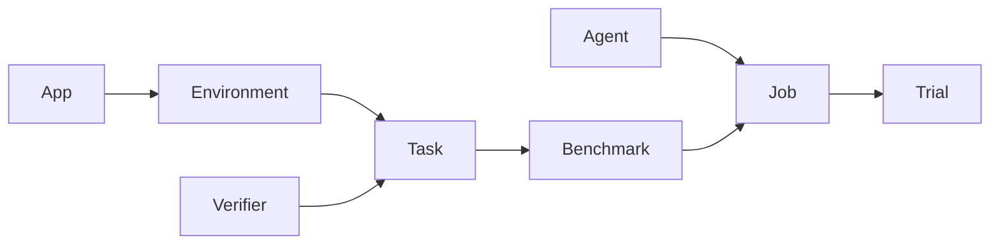

# Core concepts

Plural has a small vocabulary. Once these few words click, the rest of the docs falls
into place. We use one running example throughout: **Wordle**. The game is the world,
and each secret word is one assignment.

## The big picture

Evaluating an AI is a lot like setting an exam. You need a place where the work
happens, the questions, someone to mark the answers, and the people sitting the exam.
Plural gives each of those a name.

| Everyday idea | In Plural | Wordle example |
| --- | --- | --- |
| A system the AI works with | **App** | The Wordle game |
| The world | **Environment** | The game, and the sealed box it runs in |
| One assignment | **Task** | "The secret word is CRANE" |
| The grader | **Verifier** | Did the Agent guess the word? |
| The contestant | **Agent** | A model plus its instructions |
| The exam | **Benchmark** | Ten Wordle games with a leaderboard |
| One sitting of the exam | **Job** | "Run these three Agents on this Benchmark" |
| One attempt | **Trial** | One Agent playing one game once |

That's the whole model. The rest of this page takes each word in turn.

## App

An **App** is one system the AI can use. In Wordle, the App is the game. At a help
desk, the ticketing system is an App, and so is the orders API next to it.

Every App has two halves:

- **Actions** are the moves it offers, like `guess`. What an action returns, like the
  colored tiles, is the *only* thing the Agent ever sees.
- **State** is its private truth, like the secret word. The Agent never sees it. The
  grader reads it to check the work.

You can write an App in a few lines of Python, or plug in a system you already have:
an MCP server, an HTTP API, or recordings of an agent at work.

:::details Apps that need a login
Some systems need a token, such as a CRM API key. An App lists the **credentials** it
needs by name only. The Agent that runs supplies the values, so each Agent acts as its
own user, and every Trial records whose credential acted. Setup values the project
owns, like a database password for resetting test data, are **secrets** instead.
Neither ever reaches the model.
:::

See [Apps](../concepts/apps.md).

## Environment

An **Environment** is the world the AI is allowed to act in: one or more Apps, plus
where they run. Wordle has one App. A help desk might have three.

One Environment can host many Tasks. The Wordle game hosts one Task per secret word.

:::details What else an Environment holds
- **Runtime**: where the world runs. Usually `docker`, a sealed container on your
  machine. `local` runs directly on your computer, so only use it for code you trust.
  Hosted Runtimes run on Plural's servers.
- **Resources**: files already in the world, like a word list or a policy document,
  shared by every Task.
- **Limits**: how many turns and how long one attempt may take.
- **Party**: how many Agents share the world at once. See [Party](#party) below.
:::

See [Environments](../project/environments.md).

## Task

A **Task** is one assignment in an Environment. It has instructions in plain language
("guess the secret word in six tries"), the Environment it happens in, and one or more
Verifiers that grade it.

A Task can also set up the world before the Agent starts, such as choosing the secret
word. A good rule of thumb: how the world *works* belongs on its Apps; the facts of
*this particular case* belong on the Task.

See [Tasks](../project/tasks.md).

## Verifier

A **Verifier** is the grader. When an attempt finishes, it looks at everything that
happened, including the hidden State, and gives a **score**, usually between 0 and 1.
The Agent never sees the Verifier or its score.

There are three kinds:

- **Deterministic**: a small function that checks the answer exactly. "Did the Agent
  guess CRANE?" Use this whenever the right answer is clear-cut.
- **Agent**: a model that judges the work against written criteria, for things like
  "was the reply polite and accurate?"
- **Human**: a rubric a person fills in after the attempt.

The score is the only thing Plural ranks on.

:::details Rewards, for training
A deterministic Verifier can also hand out **rewards**: small bits of credit after
each action ("that guess found two new letters"), or once the episode is over. Plural
records them in each Trial's reward ledger, so you can train a model on its own
attempts.

Rewards and scores stay separate. A reward never changes a score unless the Verifier
says so with `check: total_reward`. The Agent never sees either. Apps never give
rewards; they only hold the facts a Verifier reads.
:::

See [Verifiers](../project/verifiers.md).

## Agent

An **Agent** is a contestant: a model from the catalog plus the instructions you give
it.

Agents are not tied to one world. The same Agent can play Wordle in one run and work
support tickets in the next. That makes comparisons fair: you are testing the Agent,
not a version of it tailored to the test.

An Agent only ever sees the Task's instructions and what its actions return. Never the
score, the rewards, the hidden State, or anything the Verifier knows.

:::details Harnesses: how an Agent plays
A **Harness** is the loop that shows the model what it can see, asks it what to do,
performs the action, and repeats. An Agent without one uses `native`, Plural's
built-in loop, which is what you want most of the time. You can also pick a
well-known one such as `claude-code` or `codex`, or write your own. A Harness doesn't
even have to call a model: the [support queue tutorial](../tutorials/support-queue.md)
uses a keyword-matching one so you can try Plural offline.

See [Harnesses](../project/harnesses.md).
:::

:::details Paying for model calls
Every model call goes through the Plural gateway, which bills it at the provider's
price, so a real run needs a Plural API key. `plural auth login` gets you one. An Agent
that never calls a model, or calls its own OpenAI-compatible endpoint, needs no key.
:::

See [Agents](../project/agents.md).

## Party

Most Tasks have one Agent working alone. Give an Environment a **party** and several
Agents share one episode instead: players at a poker table, negotiators on either side
of a deal, or a team splitting up a job.

Each Agent sits in its own **seat**. The Apps decide whose turn it is and what each
seat can see, so one player never sees another's cards. Every seat gets its own score.

See [Several Agents in one Task](../project/multi-agent.md).

## Benchmark

A **Benchmark** is the exam: a fixed, ordered set of Tasks and the rules for ranking
the results. Run several Agents on it and you get a leaderboard for your own work,
ranked by score, alongside what each Agent cost, how long it took, and how consistent
it was.

Benchmarks are versioned, so an old result is never quietly compared against a
different test.

See [Benchmarks](../project/benchmarks.md).

## Job

A **Job** is one run you start: "run these Agents on this Benchmark". It also says how
many attempts to make and how many to run at once.

Every Job pins the exact version of everything it used. That's what makes
`plural job rerun` possible: it repeats the Job with the same inputs, even if you have
edited your files since.

:::details Eval Jobs and train Jobs
**Eval** is the default, and what `plural run` does: grade the Agents and keep the
record. **Train** is the same run, but it also captures the exact text sent to and
received from the model, so a training system can learn from the attempts and their
rewards. Plural itself never changes a model's weights.
:::

See [Jobs](../running/jobs.md).

## Trial

A **Trial** is one attempt: one Agent, one Task, one try. A Job with three Agents,
ten Tasks, and two attempts each becomes sixty Trials.

Each Trial keeps a complete record: every step the Agent took (its *trajectory*), the
files it produced, logs, cost, timing, and a receipt of the exact inputs it used.

See [Trials](../running/trials.md).

## Projects

All of this lives together in a **project**: a folder with a `project.yaml` file and
one subfolder per resource, such as `environments/wordle/` or `tasks/crane/`. The
`plural` command and the Python SDK both read the same folder.

Runs happen on your machine by default. To have Plural run them for you, you **push**
the project to a private hosted project. Pushing never makes anything public.

Ready? Head to [Getting started](../getting-started.md).
