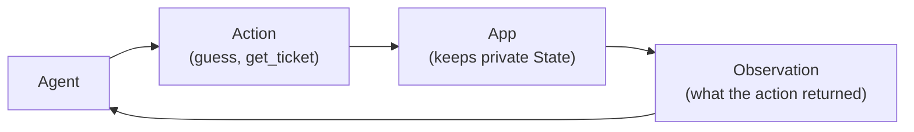

# Environments

An **Environment** is the world an Agent works in. It is a set of
[Apps](../concepts/apps.md), the systems the Agent can use, plus the Runtime they run
in and the limits of one attempt. You build it once and reuse it for many assignments,
so every Agent is tested on the same terms.

Think of a game of Wordle. The Environment has one App, the game: the Agent can
submit a guess, it sees green, yellow, and gray tiles after each one, and the secret
word stays hidden. Each secret word is a separate [Task](tasks.md), one assignment in
that world.

A support desk works the same way with more Apps. A CRM, reached through its MCP
server, holds the tickets. A table of refund policies sits beside it. Each Task picks
one ticket, and a [Verifier](verifiers.md), the grader, checks whether the work was
done correctly.

## How an Environment works

Every Environment is built from a few parts. Here they are for both examples:

| Part | What it means | Wordle | Support desk |
| --- | --- | --- | --- |
| **Apps** | The systems the Agent works with | The game | The CRM and the refund policies |
| **Actions** | The moves the Apps offer | `guess` | The CRM's tools, `policies__list_refunds` |
| **State** | Each App's private truth | The secret word, the guesses so far | The tickets and their status |
| **Observation** | What an action returns, the only thing the Agent sees | The colored tiles | A ticket, a policy row |
| **Resources** | Files already in the world | A word list | A policy document |
| **Runtime** | Where the Apps and the Agent run | Your own machine in the tutorial; a sealed Docker container for code you don't trust | The same |

The Agent works in a loop. It picks an action, the App that owns it runs it and may
change its State, and what the action returns is the Agent's next observation. That
repeats until the work is done or a budget runs out.



> **Good to know:** The Agent only ever sees the Task's instructions and what its
> actions return. It never sees an App's State, a score, or a reward.

Two things sit just outside this loop. **Rewards**, small bits of credit for
individual moves when you train a model, come from the Task's
[Verifiers](verifiers.md), never from the Environment. **Credentials**, such as the
CRM token the Agent acts with, are declared by name on the App that needs them and
supplied by the Agent that runs.

## Start with the work you want to measure

Before writing code, answer five questions:

1. **What should the Agent accomplish?** Choose one workflow, such as resolving a support ticket.
2. **Which systems does it use?** Each one is an App. Connect the ones that already exist, such as an MCP server, and write the rest in Python.
3. **What can it do?** Offer a few focused actions that match the real workflow.
4. **How will you know it succeeded?** Keep the expected outcome in State, where a Verifier can read it.
5. **When should it stop?** Decide what counts as finished, and set a turn and time budget. See [How an episode ends](#how-an-episode-ends).

Start small. Add cases and complexity once you can explain why a known good run
passes and a known bad run fails.

## Actions, State, and what the Agent sees

These three parts describe the interaction:

- **Actions** are the operations the Agent can call, such as `categorize` or `resolve`.
- **State** holds an App's private data: the expected answer and every change made
  during the run.
- **The observation** is whatever an action returns. It is the only thing the Agent
  sees after acting.

So return what the Agent should see, and never copy State into it. A Verifier reads
the final State to check the result.

This split controls what Plural shows the model. It is not a security boundary; when
you run code you don't trust, use Runtime isolation as well. See [Runtime](#runtime).

## Define the Environment

This small example lets an Agent sort one support request into the right team. It is
one Python App in one Environment:

```python
from plural import App, Environment, Runtime, State, action, initial


class Ticket(State):
    issue: str = initial("I was charged twice.", description="The customer's message.")
    expected: str = initial("billing", description="The category this ticket should receive.")
    category: str = ""


class TicketTriage(App[Ticket]):
    """Sort a support request into the right team."""

    def reset(self, initial_state):
        super().reset(initial_state)
        return f"{self.state.issue}\nChoose billing, technical, or account."

    @action
    def categorize(self, category: str) -> str:
        """Assign the ticket to billing, technical, or account."""
        if category not in {"billing", "technical", "account"}:
            raise ValueError("Choose billing, technical, or account")
        self.state.category = category
        return f"Category: {category}"

    def terminated(self) -> bool:
        return bool(self.state.category)


environment = Environment(name="ticket-triage", apps=[TicketTriage()], runtime=Runtime.local())
```

Reading it from the top:

- `Ticket` is the App's private State. Fields marked with `initial()` are the ones a
  Task can set, so each Task can bring its own ticket and expected category.
- `reset` starts a fresh attempt. The default loads the Task's starting values into
  `self.state`; what `reset` returns is the first thing the Agent sees.
- `categorize` is an action, marked with `@action`. Its docstring tells the model what
  it does, and what it returns is what the Agent sees next.
- `terminated` tells Plural the ticket is done.
- `Environment` puts the App in a Runtime. The App's name defaults to its class name
  in snake case, `ticket_triage`. App names use lowercase letters, digits, and
  underscores, because they prefix action names when there are several Apps.

`runtime` is a required Environment parameter. It selects where the Apps and the
Agent run. This example uses your own machine, which is fine for trusted development.

Typed action parameters tell the model which inputs each action accepts, and clear
docstrings help it use them well. When an action raises `ValueError`, the Agent sees
the message and the episode continues, so it can fix its input and try again. See
[Actions](../concepts/actions.md) for everything an action can return.

To use several Apps, list them all. To add an effect that spans them, such as closing
a CRM ticket when a refund goes through, subclass `Environment` and override
`on_step`. See [Compose Apps](../concepts/apps.md#compose-apps-into-an-environment).

The directory that contains the code is its source package. Keep the code and data it
needs there, and keep credentials, caches, and generated results elsewhere. Plural
records the source hash and copies the package into the Runtime.

## Save the Environment in a project

In a project, an Environment is a folder under `environments/`, named after the
Environment. Create one from the standard template:

```bash
plural env init ticket-triage
```

```text
environments/ticket-triage/
├── environment.yaml
├── server.py
├── README.md
└── resources/policy.md
```

The App is the FastMCP server in `server.py`; see
[Build an MCP server](../guides/build-mcp-server.md). With `--python`, the template
is a Python App class in `environment.py` instead. Either way the folder is the
Environment's source package, and `resources/` holds its data files. The template
also writes a starter Task, `ticket-triage-first`, and its Verifier, so
`plural run --task ticket-triage-first --model MODEL` works at once; `--bare` leaves
them out. [Create an Environment](../start/index.md) walks through replacing the
example, and every other way to start. `environment.yaml` holds everything else: its name,
Apps, resources, Runtime, and settings. This is the manifest from the
[first project](../tutorials/first-project.md), which uses a Python App:

```yaml
name: support-queue
version: 1.0.0
description: A customer support queue with one open ticket per Task.
overview: Inspect a customer ticket, categorize it, draft a reply, and resolve it.
python: environment.py:SupportQueue
readme: README.md
resources:
  - resources/policy.md
runtime:
  provider: local
harness_policy:
  mode: allow_all
limits:
  max_turns: 6
  max_seconds: 120
```

To connect an existing system instead of writing one, add it:
`plural app add NAME --mcp URL_OR_COMMAND`, `--openapi SPEC`, `--traces FILE`, or
`--files-server` creates the folder, or adds an App to an Environment you already have.
Run it once per system. `plural app list NAME` lists an Environment's Apps, and
`plural app remove NAME APP` takes one App's entry out of `environment.yaml`, leaving
its files in place. See [Start from a system](../start/from-a-system.md).

What each field means:

- `name` must match the folder name. The name and overview come from the manifest.
- `python` names either one App class, as `file.py:Class`, for an Environment of one
  Python App, or an `Environment` subclass whose `on_step` spans the Apps listed in
  `apps`.
- `apps` lists the Apps. Each entry is a Python App (`python: apps/crm.py:CRM`, with
  optional `config`), or a named `mcp`, `openapi`, or `replay` App with that kind's
  settings. See [Apps](../concepts/apps.md).
- `readme` points to `README.md`, which explains the Apps, their actions and State,
  and settings to the people who use the Environment.
- `resources` lists files to stage, relative to the folder. A path is the
  [short form](#the-short-form); a mapping takes the same fields as `Resource`.
- `runtime` picks a provider with `provider`, such as `docker`, `local`, or
  `daytona`. The other keys are that provider's settings, such as `image` or `cpus`;
  `plural runtime provider <provider>` lists them. The template uses `local`, which
  runs on your machine and is not a sandbox. To reuse a project [Runtime](runtimes.md), run
  `plural runtime use <runtime> <environment>`, which fills this block in for you.
- `harness_policy`, `limits`, `guardrails`, and `metadata` take the same values as the
  Environment arguments of those names. `limits` is what stops a run that would
  otherwise keep going. Leave the block out and there is no turn cap, and the run
  stops after 10 minutes (600 seconds). Set `max_turns` to a number to cap turns.
  `max_seconds` always stops the run.
- `party` makes it an Environment several Agents share, such as `{min: 2, max: 8}`
  for poker. See [Several Agents in one Task](multi-agent.md).

Every path must stay inside the Environment folder. Check the Environment, then save
it to your hosted project:

```bash
plural env validate ticket-triage
plural env push ticket-triage
```

`validate` loads every App and prints its kind, [control
level](../concepts/apps.md#control-levels), actions, and secrets, then the tools exactly
as the model will see them. A push saves an
unchangeable revision that stays private to the project. It refuses files that look
like credentials and paths that escape the folder. To leave out other files, list them
in a `.pluralignore` file in the Environment folder. Credentials are never stored in
the project; you supply them when the Job runs, as described in
[Secrets](#secrets).

## How an episode ends

An **episode** is one play-through, from `reset` to the end. Every Agent action is
one step, which returns the same five values Gymnasium uses. You can drive an
Environment yourself the same way, which is handy in tests:

```python
observation, info = environment.reset(initial_state={"expected": "billing"})
observation, reward, terminated, truncated, info = environment.step("categorize", category="billing")
```

The Agent only ever sees the observation. The other values describe what happened,
and Plural records them on the episode instead of showing them to the model, so a
reward or an end-of-game flag never leaks into the model's context.

An episode can stop for three reasons. Each records a different `stop_reason` on the
Trial, the record of one attempt. The full set of values is `plural.STOP_REASONS`.

- **An App ends it.** Override `terminated()` on an App when its system reaches a
  success or failure state for the Task, as the example above does once the ticket is
  categorized. Override `truncated()` when the episode can't usefully continue but
  reached neither outcome. Both default to `False`. The episode ends when any App
  says so; override them on an `Environment` subclass to decide differently.
- **The Agent ends it.** Plural adds a `finish` tool alongside the Apps' actions. The
  Agent calls it when the work is done or when it can't make progress, and its
  optional `summary` becomes the Trial's response.
- **A budget cuts it short.** `max_turns`, `max_seconds`, and `max_cost_usd` truncate
  the episode instead of failing the Trial, so you still get a trajectory and Verifier
  results. These are set on the Environment. The default, when you leave `limits`
  out, is no turn cap and 10 minutes. Set `max_turns` to a number when you want the
  run to stop after that many actions.

`terminated` and `truncated` are recorded separately from `stop_reason`, because
neither is set when the Agent chose to stop. Read `stop_reason` to tell an Agent that
finished early from a world that declared the Task over.

## Simulated time

Some worlds change on their own: customers arrive, deliveries land, rent comes due. Give
the Environment a `clock` and its Apps share one simulated time:

```yaml
clock:
  unit: day        # second, minute, hour, or day
  start: 1         # a number, or an ISO-8601 time that only labels the clock
horizon:
  sim_time: 365    # end the episode after a year; max_steps also works
autonomous: true   # the Agent can't call finish; a reply with no action waits
checkpoint_every:
  sim_time: 7      # mark a run checkpoint every simulated week
```

With a clock, Plural adds a `wait` action. A `wait` with no time runs the world to the
next thing that happens; `wait(until=12)` runs it to time 12. Every observation is
prefixed with the time, such as `Day 12`. With the default `pacing: event_driven`, time
moves only when the Agent waits; with `agent_paced`, each action also takes the time its
App's `action_duration()` returns.

An App takes part through three hooks on `App`:

- `self.schedule(at, kind, **data)` books an event, such as a delivery on day 9.
- `advance(until)` brings the App up to the clock's new time and returns what happened.
  The App host calls it at each scheduled event and at the end of every wait. Each item
  it returns is a step with `source: environment`, shown to the Agent with its time.
- `next_event_time()` says when the App next has something happen. A plain `wait` runs
  to the earliest of every App's.

`self.now` reads the clock. The episode ends with `stop_reason: horizon_reached` at the
horizon. An `autonomous` Environment never offers `finish`; set `allow_finish: true` to
offer it anyway.

### Checkpoints and resume

A long run can be interrupted: the machine sleeps, the process is killed, the sandbox is
reclaimed. With `checkpoint_every`, the App host marks a run checkpoint every period:
each App's State and RNG state, the workspace, the clock, and the Agent's context. An
interrupted Trial shows as `interrupted` in `plural job show`, with the checkpoint it can
resume from, and `plural trial resume TRIAL_ID` continues it from there. The resumed
execution is the same Trial, not a fork: its steps, States, metric points, cost, and turns
before the checkpoint are carried over, and the Trial records where it `resumed`. With the
same seed it finishes as an uninterrupted run would.

### Simulated people

A **persona** is a simulated person an App asks for an answer, such as a supplier who
quotes a price. It is part of the world, not an Agent: it is never ranked, and what its
model calls cost is the Environment's cost, reported apart from the Agent's.

```python
from plural import App, action
from plural.sim import Persona


class Suppliers(App[Orders]):
    pinecrest = Persona(
        "pinecrest",
        "You sell snacks wholesale. Quote $0.40 a unit; deliveries take 3 days.",
        model="openai/gpt-5.6-luna",
    )

    @action
    def email(self, supplier: str, message: str) -> str:
        """Write to a supplier; their reply comes back."""
        return self.pinecrest.reply(self, message, history=self.state.thread)
```

Each call is seeded from the App's RNG and recorded in the Trial's `personas.jsonl`, so a
fork or a resumed Trial replays the recorded answer instead of asking the model again.
A persona needs no clock: it can answer at once, as above, or later, when an App with a
clock schedules its reply as an event. Give it a `script` to answer without a model,
such as in a Runtime with no gateway key.

## Rewards

A **reward** is a small bit of credit for one move. It answers "which action deserved
the credit?", which is what a training system needs. A score answers a different
question: did the attempt succeed? Rewards come from the Task's Verifiers and are
recorded on the episode in every mode.

An Environment gives no rewards itself. What deserves credit depends on the Task, so
rewards come from the Task's [Verifiers](verifiers.md): a Verifier's `reward` function runs
right after each action, beside the Apps, and can read every App. See
[Reward each step](verifiers.md#reward-each-step).

:::details The precise rules
- The `reward` returned by `step` is the total of every `reward` function that gave one.
  `info["rewards"]` breaks that total down by Verifier, with its version and the App
  that acted.
- `previous_state` and `current_state` are detached JSON snapshots of the acting App,
  so read them like dictionaries rather than as your `State` class. An MCP App
  provides them only with `snapshot_on_step: true`.
- A `reward` function that raises is recorded as `0.0`, with its error in that breakdown,
  because a bug in a reward must not fail an action that already changed the world.
- `on_step` on an `Environment` subclass changes the world after an action. It can't
  return a reward.
:::

Rewards can also be assigned after the fact, from a whole trajectory, and every
reward ends up in the Trial's reward ledger. A trainer reads them from there; see
[Training and RL](../running/training.md).

## Connect Tasks and scoring

The example above always uses the same ticket. For a useful benchmark, reuse the
Environment with different case data. Each [Task](tasks.md) supplies instructions,
picks its case, and attaches one or more [Verifiers](verifiers.md).

A few rules decide what a Task can pass in:

- `initial_state` sets each App's starting State, keyed by App name, such as
  `{"crm": {...}, "policies": {...}}`. With one App, give its State directly.
- Only State fields marked with `initial()` can be set. Pass constraints such as
  `min_length=5` or `pattern=r"^[a-z]{5}$"` when a Task's value must match a rule.
- Unmarked fields, such as a running list of guesses, belong to the episode, and a
  Task cannot set them.
- Task `info` is public, so it can hold a ticket ID but should not hold the answer key.
  An App reads it in `reset` as `self.task_info`.

The [support queue tutorial](../tutorials/support-queue.md) shows how an App loads the
Task's ticket and how Verifiers score the finished workflow.

## Display views

A view is what *people* see when they watch a run in the run viewer. It is separate
from the observation, which is what the model sees. Override `view()` on an App to
control it. Plural records the view after the reset and after every step, for display
and replay only. It never reaches the Agent, and it is not scored. With several Apps,
the viewer shows the view of the App that just acted.

A view is plain data, not code. It declares a `schema` and a `kind` that the viewer
knows how to draw, so a run can never ship its own rendering script:

```python
def view(self):
    return {
        "schema": "plural.view/v1",
        "kind": "marks-grid",
        "title": "Wordle",
        "columns": 5,
        "max_rows": 6,
        "rows": [{"letters": "crane", "marks": ["absent", "present", "correct", "absent", "absent"]}],
        "status": "5 guesses left",
    }
```

Version 1 defines these kinds:

- `marks-grid` draws `rows` of `letters`, each letter marked `correct`, `present`, or
  `absent`, with an optional `title`, `columns`, `max_rows`, and `status`.
- `markdown` shows `markdown` as plain text.
- `key-values` shows `items`, a list of `{"label": ..., "value": ...}` pairs.

The viewer shows any other view, or one it can't read, as formatted JSON beside the
observation.

> **Good to know:** Everyone who can read the run can see its view, the same as
> the observation. Leave out anything that people with read access should not see. The
> Wordle example shows guesses and marks, never the secret word.

## Runtime

The **Runtime** is where the world runs: a sealed container, your own machine, or a
remote machine. Choose one based on where the code should run and which controls you
need. Plural checks support before running and fails if the chosen provider can't
enforce a control you asked for.

In short:

- **Local** runs on your computer. Use it only for code you trust.
- **Docker** runs in a sealed container on a machine with Docker installed.
- **Remote** runs on a machine from a remote provider. The bundled provider is Daytona.

### Local

```python
Runtime.local()
```

Use this for trusted development. Plural runs a subprocess in a temporary workspace
on your machine. Local execution does not provide a sandbox, network isolation, or
compute limits. `Runtime.local()` explicitly enables local execution through
`allow_unsafe_local`.

### Docker

```python
Runtime.docker()
Runtime.docker(image="my-org/eval:1")
Runtime.docker(cpus=2, memory_mb=2048, read_only_root=True)
```

Use Docker for container isolation on a machine with Docker installed. The default
image is `python:3.12-slim`. The workspace stays writable when the root filesystem is
read-only. Pin an image digest when you need reproducible system dependencies.

To install more dependencies, put a Dockerfile beside the Environment:

```dockerfile
FROM python:3.12-slim
WORKDIR /workspace
COPY requirements.txt .
RUN pip install --no-cache-dir -r requirements.txt
```

```python
Runtime.docker(dockerfile="Dockerfile", build_context=".")
```

`build_context` is the folder Docker uses for the build. Builds time out after 600
seconds by default. Choose one image source: a registry image, a snapshot, a
declarative image, or a Dockerfile.

### Remote

Use a remote Runtime to run away from your machine. The bundled provider is Daytona.
Install the remote integration and set `DAYTONA_API_KEY`:

```bash
python -m pip install "plural[daytona]"
```

```python
Runtime.daytona(image="python:3.12-slim")
```

Remote execution needs an image or snapshot the provider can reach. It can't build
from a Dockerfile on your laptop. See
[Providers and integrations](../reference/integrations.md) for setup and extensions,
and [Runtimes](runtimes.md) to set up a Daytona sandbox once and reuse it across
Environments.

### Network

Model calls run inside the Runtime, so it needs to reach the model endpoint. Choose
the narrowest network access that still supports your workflow:

- `public` allows outbound connections, and is the default.
- `no-network` blocks outbound connections.
- `allowlist` permits only the hosts listed in `allowed_hosts`, on a provider that
  supports it.

Local execution can't isolate networking. Docker can block outbound traffic but does
not enforce a host allowlist. The remote provider supports allowlists:

```python
Runtime.daytona(
    image="python:3.12-slim",
    network="allowlist",
    allowed_hosts=("api.openai.com",),
)
```

Use your actual model endpoint hostname. Verifiers have their own `VerifierRuntime`;
model judges also need to reach their endpoint.

### Compute, timeouts, and persistence

`cpus` and `memory_mb` request compute limits on providers that support them.

Two limits bound time, and each governs different commands:

- The Environment's `max_seconds` governs the Harness, however long it is. An
  episode can run for hours or days; the sandbox's lifetime is set from it.
- The Runtime's `timeout_seconds`, 900 seconds by default, governs every other
  command: setup, uploads, the App host's start, and downloads. It never cuts an
  episode short.

Plural's built-in Harness ends the episode itself at `max_seconds`, with the stop
reason `max_seconds`, and its Trial is verified like any other; the Runtime allows it
30 seconds past that to finish. A Harness of your own is killed at `max_seconds`, and
is told that deadline, in seconds, in `PLURAL_STOP_SECONDS`. A Trial killed that way
fails with the stop reason `harness_timeout`; a Benchmark's
[`harness_timeout` rule](benchmarks.md#how-failures-are-scored) decides whether it
counts against the Agent.

Set the episode limits on the Environment:

```python
from plural import Environment, ExecutionLimits, Runtime

environment = Environment(
    apps=[TicketTriage()],
    runtime=Runtime.local(),
    limits=ExecutionLimits(max_turns=4, max_seconds=60),
)
```

The default episode limits are no turn cap and 600 seconds (10 minutes), used
whenever an Environment leaves `limits` out. Change the limits on the Environment:

```yaml
limits:
  max_turns: 40
  max_seconds: 1800
```

`max_turns: null` is the default and means no turn cap. Set it to any positive
number to stop the run after that many actions. The time limit still stops the
run. In the hosted editor a new Environment starts with the same defaults: an
empty turn field and 10 minutes. Clear or set the turn field before the first run.
An optional `max_cost_usd` sets a cost budget, based on the usage the runner can
measure.

Local, Docker, and the bundled remote provider do not keep workspaces between Trials.
Recreate the data each Trial needs in `reset`.

### Workspace snapshots

After every step, Plural snapshots the Agent's workspace files, so a Verifier can
read the files the Agent left as `episode.workspace` and a fork can put the files
back exactly as they were after any step. Snapshots never hold the Environment's
resources, a Harness's own files, or an App's private files. `workspace_snapshot_mib`
in `limits`, 512 by default, caps the snapshot's size per Trial; files past the cap
are listed as skipped, and `0` turns snapshots off. Snapshots need `git` in the
Runtime.

## An Environment with no Apps

An Environment needs no Apps when the work is answering a question or editing files.
Give it resources and a Runtime, and Verifiers check the Agent's final answer and
the files it wrote:

```yaml
name: files
resources:
  - invoices.csv
runtime:
  provider: local
```

The Agent works with its Harness's own tools, such as Claude Code's `Read` and
`Write`. Every tool call is a step in the Trial's timeline. The
`examples/bare-files` project in the [Plural repository](https://github.com/lastlabs-ai/plural)
totals a CSV file and checks the total in both the answer and a file.

## Forkable Environments

A fork continues a Trial from the moment after one step, with every App's State put
back. An Environment is **forkable** when every App can do that. A Python App can,
unless its class sets `restorable = False`; override `restore(snapshot)` when
loading the snapshot into `self.state` isn't enough. An MCP or OpenAPI App can when
it has `snapshot` and `restore` commands and snapshots after every step. A `live`
App never can. `plural env validate` and the Environment's page say whether an
Environment is forkable, and why not. See [Checkpoints and forks](../running/forks.md).

## Resources

**Resources** are the files and data the world starts with, like the Wordle word list
or the support policy. Think of them as volumes. The Environment has one, shared by
every Task. A Task may have its own, for one case, such as a single customer's invoice.
A Trial references both, read-only; it doesn't own them, and nothing done in a Trial
changes them. The two sit side by side and never share a path:

```text
/workspace/resources/
  environment-resources/   # The Environment's files, for every Task
    policies/refunds.md
  task-resources/          # This Task's files, when it has any
    invoice.csv
  manifest.json            # Every file's location and SHA-256 hash
```

Use relative file paths. `PLURAL_RESOURCES_DIR` holds the root folder. A FastMCP server
reads the two folders with `plural.mcp.environment_resources()` and
`plural.mcp.task_resources()`; see
[Build an MCP server](../guides/build-mcp-server.md#read-files).
For files the Agent should browse and query directly, add Plural's files server as an
App: `server: plural.mcp.files:server`.

The Agent reaches the files through the Apps' tools. A Harness that can read files,
such as a coding agent, can also read both folders directly.

> **Good to know:** Files are not added to the model's prompt automatically. The Agent
> only learns what a tool returns.

There are four ways to supply a resource. The short form covers most cases; the rest
are for power users.

### The short form

A file that already lives next to your Environment code needs one line. Plural stages
it from the source package automatically:

```python
from plural import Resource

policy = Resource("policies/refunds.md")
```

That is `kind="file"` and `delivery="source"`, with the name defaulting to the path.
Pass `resources=[policy]` when you create the Environment. In `environment.yaml`, list
the same path under `resources`.

### Saved text and configuration

To keep a small text file with the Environment itself, pass its content:

```python
from plural import Resource

policy = Resource(
    "policies/refunds.md",
    content="Refund duplicate charges after confirming the invoice.",
    content_type="text/markdown",
)
```

Pass `resources=[policy]` when you create the Environment. Plural calculates the
content hash and writes the file before reset. Inline resources support text, CSV,
JSON, and other UTF-8 configuration, up to 1 MiB of characters and the 16 MiB
staged-file limit. They are stored with the Environment, so use runtime secrets for
credentials.

### Packaged files

The short form already stages a file from the Environment's source package into the
resource folder. The explicit mapping form says the same thing:

```python
policy = Resource(
    kind="file",
    name="policies/refunds.md",
    path="policies/refunds.md",
    delivery="source",
)
```

The path must point to a file inside the package. Source files may be binary. Each
staged file is limited to 16 MiB. The manifest records the actual hash; an optional
`digest` requires an exact match.

### Data resolved at launch

For data that lives elsewhere, such as in your ticketing system, store its location,
a resolver name, configuration, and the expected hash. Then give the Job the resolver
that fetches it:

```python
import hashlib
from plural import Job, Resource

expected_bytes = b'{"ticket_id": "ticket-123", "category": "billing"}'
ticket = Resource(
    kind="data",
    name="ticket",
    path="ticket.json",
    delivery="resolver",
    uri="support://tickets/ticket-123",
    resolver="support-ticket",
    config={"ticket_id": "ticket-123"},
    digest="sha256:" + hashlib.sha256(expected_bytes).hexdigest(),
)

def load_ticket(resource: Resource) -> bytes:
    # Replace this fixture with a read from your data service.
    # Set a timeout on external calls and return a stable encoding.
    assert resource.config["ticket_id"] == "ticket-123"
    return expected_bytes

# Add ticket to the Task's resources before creating this Job.
job = Job(task, agents=[agent], resource_resolvers={"support-ticket": load_ticket})
```

The rules:

- Resolvers run in the Job process before the Agent starts. They receive the resource
  declaration and return bytes.
- Plural rejects missing resolvers and mismatched hashes.
- Register resolvers in the process that runs the Job. Naming a resolver in a manifest
  or in the web app does not install it for hosted runs.
- A URI alone is never fetched automatically.

A `Resource` declared with explicit fields and no `delivery` is a `descriptor`: Plural
records the reference but stages no file, and your Environment code must load the data
itself.

## Secrets

An App never holds a credential's value; it lists the names it needs, and they are
supplied when a run starts, so nothing secret is saved with the Environment. A
**credential** is supplied by the Agent that runs, so each Agent acts with its own token
and scopes. A **secret** is supplied by the project, for setup only, such as a reset
hook's admin token:

```python
from plural import App

crm = App.mcp(
    "crm",
    url="https://mcp.example.com/v1",
    headers={"Authorization": "Bearer ${CRM_TOKEN}"},
    credentials=["CRM_TOKEN"],
)
```

A Job checks before it starts anything that the Agent declares every credential and
has a value for each, and that every secret has a value, and fails at once, naming the
App and the name. The Agent lists its credentials, with their scopes, in its
`agent.yaml`, and each person who runs it saves their own value with
`plural credential set NAME`. A secret comes from your
shell when you exported it, and otherwise from the hosted project, where
`plural secret set NAME` stores it encrypted. Values go only to the process that runs
the Apps and to Verifier queries, never to the model or its Harness. See
[Credentials and secrets](../concepts/apps.md#credentials-and-secrets).

### Runtime variables

Settings that belong to the Runtime rather than one App, such as the address of a
service the Environment's code reads, are declared as variables on the Runtime and
supplied when the Job starts:

```python
import os
from plural import Job, Runtime, RuntimeVariable

runtime = Runtime.docker(variables=[
    RuntimeVariable(
        name="SUPPORT_API_URL",
        format="url",
        description="Base URL of the support API.",
    ),
])

# Use this runtime when constructing your Environment and Task.
job = Job(task, agents=[agent], environ={"SUPPORT_API_URL": os.environ["SUPPORT_API_URL"]})
```

The precise rules:

- Required declarations must have a nonempty value. Set `required=False` for optional
  inputs.
- Supported formats are `text`, `url`, `integer`, and `json`.
- Values are injected into the Apps' process. Declarations never contain values.
- The Harness, the loop that drives the Agent, shares the Runtime and can read
  Runtime variables, so put credentials on Apps instead.

Docker and Daytona connection credentials configure the machine that runs the Job,
separately from these variables. Plural checks that the provider is available and
supports the requested controls when a run starts.

Model calls are authenticated through the Job's `client` or `api_key` parameter, and
go through the Plural gateway, so `plural run` needs a Plural API key: one stored
with `plural auth login`, or an exported `PLURAL_API_KEY`. An Agent that calls its own
OpenAI-compatible endpoint needs none; see [Agents](agents.md).

## Optional components

- **Metadata:** use `name`, `version`, and `overview` to identify the Environment; use
  `metadata` for labels and ownership.
- **Display:** return an `Observation` with a `render()` method from an action to
  control the text the model reads exactly, and override `App.view()` to control what
  people see in the run viewer. See [Display views](#display-views).
- **Harness policy:** limit which custom Harnesses may run here and what they may do.
  See [Harnesses](harnesses.md).
- **Rewards:** give per-step credit from a Task's Verifiers. See [Rewards](#rewards).

## Build a complete example

Continue with [Tasks](tasks.md) to add cases to your Environment, or follow an
end-to-end tutorial:

- [Support queue](../tutorials/support-queue.md): inspect, categorize, answer, and resolve three tickets.
- [Wordle](../tutorials/wordle.md): guess a hidden word using feedback from one action.
